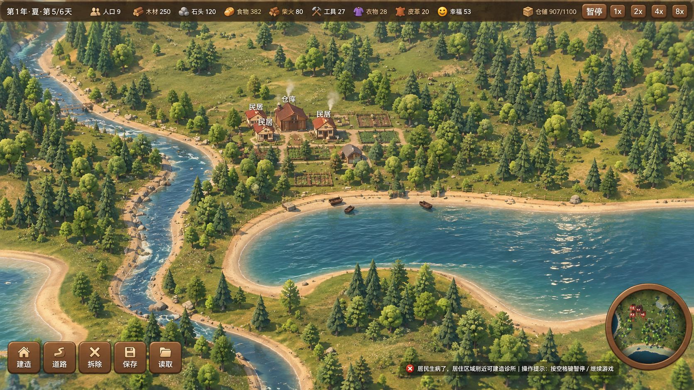
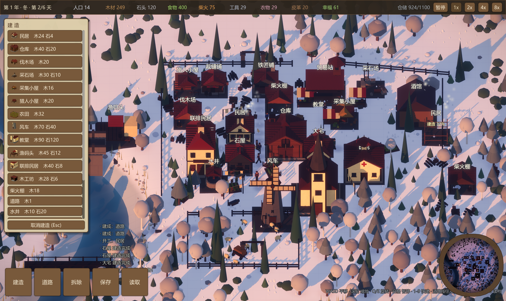
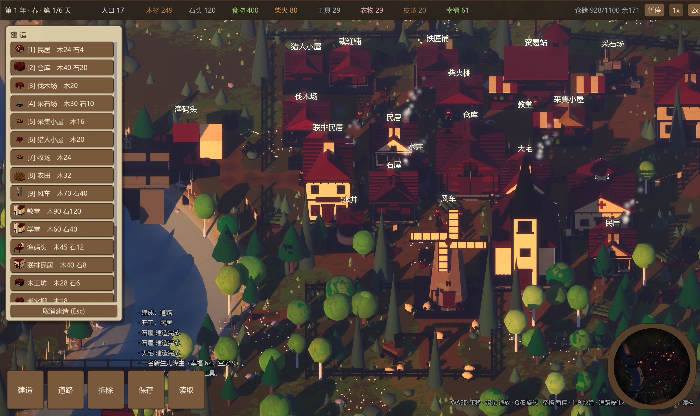
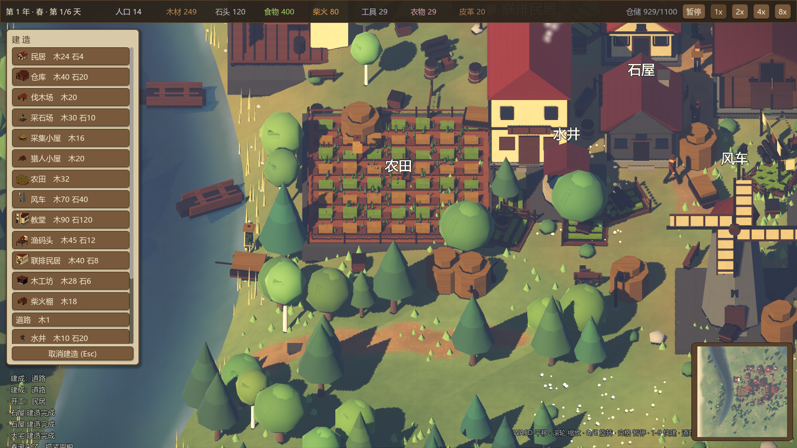
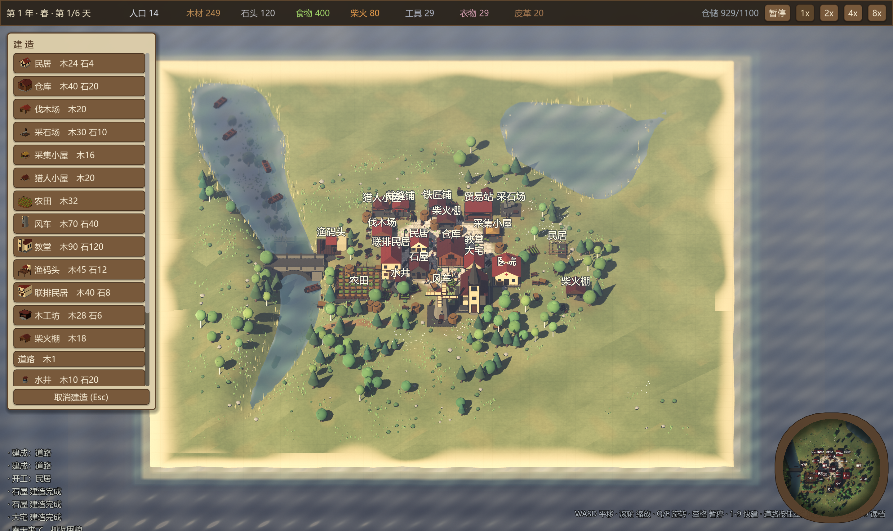
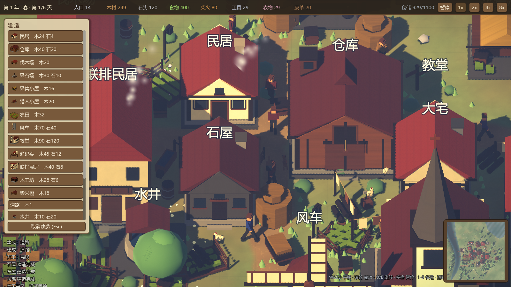

# 放逐之城 · 复刻原型

> **Godot 4.7** 下的《Banished / 放逐之城》玩法向垂直切片：等距视角经营一座被流放的聚落，在四季与灾害中活下去并壮大。

## 游戏简介

你被赶到一片陌生的海岸。没有城墙、没有援军，只有几名同伴、一小堆物资，和一片会起伏、会结冰、会下雨的野地。你要做的，和经典《放逐之城》一样：**先让肚子不饿、冬天有柴，再慢慢把伐木→柴火、采石→建造、采集/农田/渔猎→口粮、猎人→皮革→裁缝→衣物、铁匠/木工→工具，以及贸易换购一条链接起来**，让人口与仓库一起涨上去。

本作是**可玩的复刻原型**，不是 1:1 还原。它保留了放逐类核心的节奏感——规划布局、指派劳力、盯库存、为过冬留余量——并在一座 **64×64 的程序化岛屿**上把体验跑通：从第一间伐木场到教堂与贸易站，从春播到积雪，从晴天到雨雪。建筑会按工期施工、道路能穿林爬坡，居民会在地图上寻路劳作；幸福度、仓容、工具与衣物消耗、贸易与升级、存档读档都已接入，适合用来验证「这类城镇生存经营在 Godot 里能做到哪一步」。

**你会体验到：**

- **生存经营**：木材、石材、食物、柴火、工具、衣物、皮革等资源与仓库上限；人口增长与日常消耗。
- **生产网络**：24 种建筑覆盖采集、种植、狩猎、放牧、加工与服务（含牧场副产皮革、学堂学童效率圈、酒馆幸福）；数值由 `data/buildings.json` 驱动（启动日志「载入 N 条」含升级项键，菜单可建 **24** 种）。
- **时间与气候**：昼夜循环、四季更替（含冬季采暖与地表变化）、动态雨雪天气。
- **世界感**：河谷、湖泊、海岸、远林与场景道具（市场、码头、喷泉、桥梁等），配合程序化材质与后期调色。
- **操作与辅助**：等距相机、建造菜单与小地图、F5/F9 存读档、空格暂停与倍速。
- **居民与贸易**：个体有饥饿/体温/健康与瘟疫；医院值守加速康复；死亡累计 `dead_count` 并在教堂南/民居旁立简易墓碑（读档可重建 `tombstones[]`），顶栏可显示「亡 N」；贸易站有人值守时每 6 日自动以 4:1 换购（缺粮→食物、缺柴→柴火、石料偏低→石头，否则工具/衣物），选中贸易站可看 **5 项**可购入预览并额外手动贸易（每日一次）；行商事件可顺带补工具/衣/石/柴。

技术栈：**Godot 4.7.2 + GDScript**；建筑与道具 **glb** 由 **Blender 5.0** 脚本 `tools/build_assets.py` 程序化生成，运行时无外部贴图依赖。









## 运行

```powershell
& 'D:\04_Godot\Godot_v4.7.2-stable_win64.exe' --path 'D:\01_code\00_fzzc'
```

首次打开（或新增了 glb 资源）需要让 Godot 扫一遍，否则 `class_name` 和模型都找不到：

```powershell
& 'D:\04_Godot\Godot_v4.7.2-stable_win64_console.exe' --headless --path 'D:\01_code\00_fzzc' --import
```

## 操作

| 操作 | 键位 |
|---|---|
| 平移 | WASD / 方向键 / 鼠标贴边 |
| 缩放 | 鼠标滚轮 |
| 旋转视角 | Q / E，或**按住鼠标中键拖动** |
| 调整俯角 | 按住鼠标中键上下拖动 |
| 全屏切换 | F11 |
| 暂停 | 空格 |
| 快速建造 | 1–9（9 是道路） |
| 铺路 | 选「道路」后<b>按住左键拖动</b>连续铺，右键擦除 |
| 存档 / 读档 | F5 / F9 |
| 随机事件调试 | F8（开关与事件权重 ±0.1，写入存档的 `event_weights`） |
| 取消建造 / 取消选中 | 右键 或 Esc |
| 选中建筑 | 左键点击；有岗位建筑可 **优先指派** / **锁定工人**（读档保留） |

道路可以穿过森林（自动清树）并能爬坡，陡处自动铺石阶。

## 画面构成

| 层 | 内容 |
|---|---|
| 相机 | 等距正交，俯角 44° |
| 地形 | 64×64 高度场（`ArrayMesh` 位移），中央平台 + 河谷下切 + 湖 + 海岸沙滩 |
| 地表 | fbm 草色 + 枯草斑块 + 细颗粒 + 道路遮罩 + 裸土遮罩 + 建造网格 |
| 水体 | 深度遮罩着色 + 菲涅尔天空反射 + 岸边透明 + 泡沫 + 波浪 + 小船 |
| 建筑材质 | 三平面程序化（木纹 / 瓦片 / 石砌 / 灰泥），每栋随机色差 |
| 植被 | 3 树种 × 双层树冠 × 每棵色差 + 灌木 + 岩石 + 4200 草簇 + 花丛 + 岸线芦苇 |
| 生命 | 居民（随机衣色/身高、Catmull-Rom 平滑寻路）+ 7 鸡 3 狗 |
| 光照 | 暖色主光 + 冷蓝环境光 + 4 级阴影 + SSAO，冬季增强环境光 |
| 后期 | ACES + 景深 + 辉光 + 雾 + 分离色调 + 暗角 + 颗粒（`shaders/grade.gdshader`） |
| 动态 | 昼夜循环（80 秒一周，黄昏窗户透光）+ 四季（作物/积雪/风车转速）+ 雨雪天气 |
| UI | 羊皮纸/木牌主题 + 建筑 3D 缩略图 + 可滚动菜单 + 跟随小地图 |

## 建筑（24 种）

| 类别 | 建筑 |
|---|---|
| 住宅 | 民居、石屋、大宅、联排民居 |
| 仓储 | 仓库（钟楼、阁楼货门、吊装梁） |
| 食物 | 采集小屋、猎人小屋、**牧场**、农田、渔码头、风车 |
| 原料 | 伐木场、采石场、柴火棚 |
| 加工 | 裁缝铺、铁匠铺、木工坊 |
| 服务 | 水井、医院、教堂、学堂、酒馆、贸易站 |
| 交通 | 道路 |

数值表在 `data/buildings.json`（由 `tools/export_defs.gd` 从 `scripts/BuildingDefs.gd` 导出，**JSON 为运行时权威**）。

## 场景道具（17 种）

木桶、板条箱、干草堆、手推车、长椅、路灯、栅栏、小船、鸡、狗、晾衣绳、木料堆、干草车、饮水槽、路牌、菜园、稻草人。

按建筑类型规则化放置（`CTX_WANT`）：住宅配菜园/晾衣绳/木料堆，农田配稻草人/干草车，水井配水槽，仓库/贸易站配路牌。

## 存档（version 2）

`user://save.json`，由 `Main.save_game` / `load_game` 读写（当前仅写入 **version 2**；无 `version` 的旧档勿直接依赖）。

| 字段 | 含义 |
|---|---|
| `version` | 固定 `2` |
| `t` | 游戏时间（秒） |
| `stock` | 各资源存量 |
| `happiness` | 幸福度 |
| `trade_manual_day` | 上次手动贸易的游戏日（-1 表示从未） |
| `cold_snap_days` | 寒潮剩余天数（缺省 `0`） |
| `random_events_enabled` | 是否启用随机事件与难民（缺省 `true`） |
| `event_weights` | 事件 id → 权重倍率（缺省或空对象 → `GameEvents.WEIGHT_DEFAULTS`） |
| `dead_count` | 累计死亡人数（缺省 `0`） |
| `tombstones[]` | 墓碑世界坐标 `[x, z, rot_y]`（缺省 `[]`；旧档无此键则只恢复 `dead_count`、不重建场景墓碑） |
| `buildings[]` | `id`、`cell`、`complete`、`progress`、`produced`、`burning`、`burn_timer`、`worker_ids` / `builder_ids`（居民下标）；可选 `lock_workers`、`job_priority` |
| `citizens[]` | 平面坐标 `pos`、`age`（游戏日）、`hunger` / `warmth` / `health`、`sick`、`carry` / `carry_res`、`home` / `work` / `site`（建筑下标） |

读档后会重算寻路阻挡、重新分配岗位，并 `_relocate_citizens_after_load` 修正卡在固体格上的居民；事件相关字段经 `GameState.apply_save_event_fields` 恢复（旧档缺键用上表缺省）。

## 随机事件（GameEvents）

`GameEvents.try_daily` 由 `Main._try_disaster` 每日调用；`GameEvents.try_refugees` 在春季额外判定难民。开关与权重在 **`GameState`**（无 UI，可脚本改）：

| 变量 | 说明 |
|---|---|
| `random_events_enabled` | `false` 关闭全部随机事件与难民（`--autotest` 会自动关闭） |
| `event_weights` | 键 → 倍率，默认见 `GameEvents.WEIGHT_DEFAULTS`：`fire`、`plague`、`food_shortage`、`cold_snap`、`good_harvest`、`traveling_merchant`、`refugees`（1.0 = 设计基准日概率） |

建成建筑 **&lt;3** 时不触发；前期日数少、建筑少时负面事件另有衰减系数。火灾点燃后蔓延/扑灭逻辑仍在 `Main._tick_fires`。调试时可按 **F8** 打开面板（详见操作表）。

## 测试与截图

```powershell
$e = 'D:\04_Godot\Godot_v4.7.2-stable_win64_console.exe'
& $e --headless --path . -- --autotest     # 跑 1.5 游戏年，检查经济与建造
& $e --headless --path . -- --savetest     # 存读档往返一致性
& $e --path . -- --shot --town             # 截图（见下表）
```

| 截图参数 | 效果 |
|---|---|
| `--shot --town` | 演示城镇（默认 `--at 54 66 --size 38`；**固定暖色斜照 k≈0.52**，对齐概念 v3 河湖+主聚落） |
| `--shot --winter --town` | 冬季 |
| `--shot --town --dusk` | 更晚黄昏（k≈0.74，偏橙；README 用 `shot_dusk.png`） |
| `--shot --town --rain` | 雨天 |
| `--shot --winter --town --rain` | 雪天 |
| `--shot --far --town` | 全岛 |
| `--shot --at 45 73 --size 24` | 指定相机中心与视野 |
| `--shot --cutshadow buildings` | 关闭某组投影（排查用） |

## 已知问题

- **建筑坡地贴合**：坡度上限 1.2 米，超过则拒绝建造；石基台基向下延伸 1.1 米盖住缝隙，但极端地形仍可能有轻微穿模。
- **水面无真实反射**：用深度色 + 菲涅尔近似，没有屏幕空间反射。
- **阴影柔边受限**：`shadow_blur` 必须保持很低（0.12），否则在正交大视锥下会产生条带。

## 自测基线

`--autotest` 末尾 `[8]` 与 `--savetest` 的 `before` / `after` 字符串应一致（随机事件已关）。

```
[8] 第2年 夏 第3天 | 人口=14 | 木=258 石=120 食=392 柴=91 | 建筑=12 | 仓容=1100
SAVETEST before=pop=9 bld=9 wood=250 food=400 fire=80 day=1
SAVETEST after =pop=9 bld=9 wood=250 food=400 fire=80 day=1
SAVETEST events before=ev=false fire=0.35 cold=2
SAVETEST events after =ev=false fire=0.35 cold=2
```

说明：`--autotest` 建造计划**全部**经 `find_build_cell` 选址并以免费 instant 完工，不应出现 `AUTOPLAY 建造失败`；`SELFTEST` 校验学堂/码头放置与存档 v2 事件字段内存往返。

## 目录

```
scripts/     Main.gd（世界/建造/命令）、GameState.gd（资源/时间/贸易/幸福）、GameEvents.gd（随机事件）、
             Building.gd、Citizen.gd、Critter.gd、GridSystem.gd、GameUI.gd、ModelPaint.gd、BuildingDefs.gd
shaders/     ground / water / surface / grade / smoke / rain
assets/models/  建筑 glb（学堂暂复用 church）+ 17 个道具 glb + character.glb
data/        buildings.json
tools/       build_assets.py（Blender 生成）、export_defs.gd、concept_render.py 等
```
